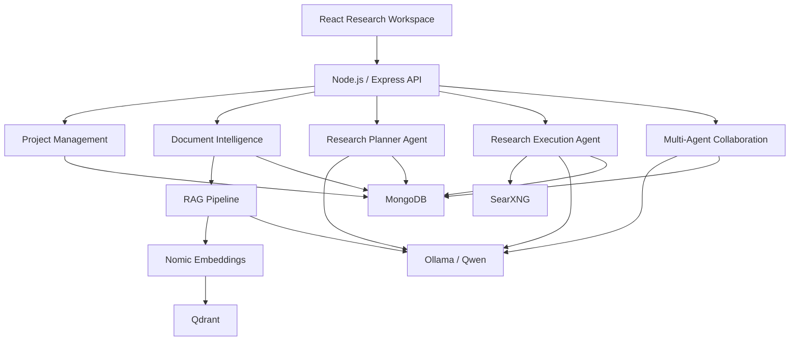

# ResearchOS 🔬

**An open-source, agentic AI research platform that plans, executes, analyzes, and synthesizes research using autonomous AI agents.**

ResearchOS is an AI-powered research workspace designed to transform how people conduct complex research. It combines local Large Language Models (LLMs), Retrieval-Augmented Generation (RAG), web search, and multi-agent orchestration to automate the research lifecycle.

Instead of relying on a single AI assistant, ResearchOS uses specialized agents that collaborate to investigate research questions, collect evidence, analyze findings, and produce structured research outputs.

The goal is to build an intelligent research system that can work autonomously while keeping research evidence, sources, and findings organized and traceable.

---

## ✨ Key Features

### 🧠 Local LLM Integration
- Run AI models locally using Ollama.
- Integrate Qwen models through LangChain.
- Keep model execution under your control.
- Build AI workflows without depending entirely on proprietary LLM APIs.

### 📚 Document Intelligence & RAG
- Upload PDF, DOCX, and TXT documents.
- Extract and chunk document content.
- Generate embeddings using local embedding models.
- Store and retrieve document vectors using Qdrant.
- Ask questions against project-specific documents.
- Generate context-aware answers with source references.

### 🗺️ AI Research Planner
- Convert research objectives into structured research plans.
- Automatically identify research areas.
- Break complex objectives into actionable research tasks.
- Prioritize tasks and track research progress.

### 🔎 Autonomous Research Execution
- Execute research tasks using AI research workers.
- Search the web through SearXNG.
- Extract content from web pages.
- Identify evidence and supporting sources.
- Store research findings and collected sources.
- Track execution status and results.

### 🤖 Multi-Agent Collaboration
ResearchOS is designed around specialized AI agents that collaborate to conduct research.

Planned and implemented agent responsibilities include:

| Agent | Responsibility |
|---|---|
| Research Coordinator | Coordinates the research workflow and delegates tasks |
| Market Research Agent | Investigates markets, competitors, pricing, and trends |
| Technical Research Agent | Evaluates technologies, architectures, and feasibility |
| Regulatory Research Agent | Investigates regulations and compliance requirements |
| Data Analysis Agent | Identifies patterns, comparisons, and insights |
| Quality Assurance Agent | Reviews evidence, source quality, and conflicting claims |

### 📊 Research Workspace
- Manage research projects.
- Organize research sessions.
- Manage research plans and tasks.
- Execute research from saved plans.
- Review research findings and sources.
- Track execution progress.

---

## 🏗️ Architecture

ResearchOS follows a modular architecture that separates project management, document intelligence, research planning, research execution, and agent collaboration.



### Technology Stack

| Layer | Technologies |
|---|---|
| Frontend | React, TypeScript, Vite |
| Backend | Node.js, Express, TypeScript |
| AI orchestration | LangChain, LangGraph |
| LLM | Ollama, Qwen |
| Embeddings | Nomic Embed Text |
| Vector database | Qdrant |
| Database | MongoDB |
| Web search | SearXNG |
| Document extraction | PDF.js, Mammoth |
| Validation | Zod |
| Data fetching | TanStack Query, Axios |

---

## 🚀 Getting Started

### Prerequisites

Make sure you have the following installed:

- Node.js (LTS recommended)
- npm
- MongoDB
- Docker
- Ollama
- Git

### 1. Clone the repository

```bash
git clone https://github.com/YOUR_USERNAME/researchos.git

cd researchos
```

### 2. Install backend dependencies

```bash
npm install
```

### 3. Install and configure Ollama

Install Ollama from:

https://ollama.com/

Pull the required models:

```bash
ollama pull qwen3:4b
ollama pull nomic-embed-text
```

Verify installed models:

```bash
ollama list
```

Make sure Ollama is running:

```bash
ollama serve
```

### 4. Start MongoDB

For macOS with Homebrew:

```bash
brew tap mongodb/brew

brew install mongodb-community@8.0

brew services start mongodb-community@8.0
```

MongoDB connection:

```text
mongodb://127.0.0.1:27017/researchos
```

### 5. Start Qdrant

Run Qdrant using Docker:

```bash
docker run -d \
  --name researchos-qdrant \
  -p 6333:6333 \
  -p 6334:6334 \
  -v researchos_qdrant:/qdrant/storage \
  qdrant/qdrant
```

Qdrant dashboard:

http://localhost:6333/dashboard

### 6. Start SearXNG

Run the SearXNG service using Docker and your configured `settings.yml`.

Example:

```bash
docker run -d \
  --name researchos-searxng \
  -p 8888:8080 \
  -v ./searxng:/etc/searxng \
  searxng/searxng
```

Verify:

http://localhost:8888

Use your configured SearXNG settings and secret key. Do not expose a development configuration publicly.

### 7. Configure environment variables

Create a `.env` file in the backend root:

```env
PORT=4000

MONGODB_URI=mongodb://127.0.0.1:27017/researchos

OLLAMA_BASE_URL=http://localhost:11434
OLLAMA_MODEL=qwen3:4b
OLLAMA_EMBEDDING_MODEL=nomic-embed-text

QDRANT_URL=http://localhost:6333
QDRANT_COLLECTION=researchos_documents

SEARXNG_BASE_URL=http://localhost:8888
SEARXNG_TIMEOUT_MS=15000
SEARXNG_MAX_RESULTS=10
```

Adjust the configuration according to your local environment.

### 8. Start the backend

```bash
npm run dev
```

Backend:

http://localhost:4000

### 9. Start the frontend

Open another terminal:

```bash
cd client

npm install

npm run dev
```

Frontend:

http://localhost:5173

---

## 📁 Project Structure

```text
researchos/
│
├── src/
│   ├── agents/
│   │   ├── research-planner/
│   │   ├── research-execution/
│   │   └── research-collaboration/
│   │
│   ├── config/
│   │   ├── database.ts
│   │   ├── llm.ts
│   │   ├── embeddings.ts
│   │   └── vector-store.ts
│   │
│   ├── modules/
│   │   ├── projects/
│   │   ├── documents/
│   │   ├── research/
│   │   ├── research-plans/
│   │   └── research-execution/
│   │
│   └── server.ts
│
├── client/
│   ├── src/
│   ├── public/
│   └── package.json
│
├── .env.example
├── package.json
└── README.md
```

---

## 🧪 Development Roadmap

ResearchOS is being developed incrementally.

| Phase | Description | Status |
|---|---|---|
| 1 | Local LLM Setup | ✅ Completed |
| 2 | Backend Foundation & MongoDB | ✅ Completed |
| 3 | Document Intelligence & RAG | ✅ Completed |
| 4 | React Frontend | ✅ Completed |
| 5 | AI Research Planner Agent | ✅ Completed |
| 6 | Autonomous Research Execution Agent | ✅ Completed |
| 7 | Multi-Agent Collaboration | 🚧 In Progress |
| 8 | Research Analysis & Synthesis | 📋 Planned |
| 9 | Research Report Generation | 📋 Planned |
| 10 | Evaluation, Optimization & Production Readiness | 📋 Planned |

---

## 🎯 Vision

The long-term vision for ResearchOS is to create an autonomous AI research environment capable of:

- Understanding complex research objectives.
- Creating structured research plans.
- Delegating work to specialized agents.
- Conducting autonomous web research.
- Reading and understanding uploaded documents.
- Collecting and validating supporting evidence.
- Detecting contradictions and research gaps.
- Synthesizing findings from multiple sources.
- Generating comprehensive research reports.

ResearchOS aims to make sophisticated AI-assisted research accessible through an open-source, extensible architecture.

---

## 🤝 Contributing

Contributions, suggestions, and feedback are welcome.

If you would like to contribute:

1. Fork the repository.
2. Create a feature branch.
3. Implement your changes.
4. Submit a pull request.

For significant changes, consider opening an issue first to discuss the proposed implementation.

---

## ⚠️ Current Development Status

ResearchOS is an actively developed project and is not yet production-ready.

Some capabilities are still being implemented and integrated. Research outputs should be independently verified, especially for legal, regulatory, financial, and other high-impact decisions.

Local model performance, search availability, and output quality depend on the configured models and infrastructure.

---

## 📄 License

Choose and add an appropriate open-source license before publishing the repository. For example, MIT is a permissive option if you want others to freely use, modify, and distribute the project.

---

**Built with ❤️ using open-source AI technologies.**
